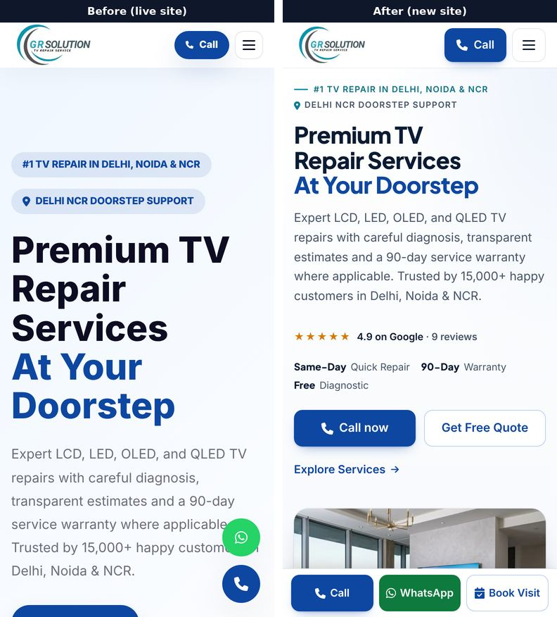
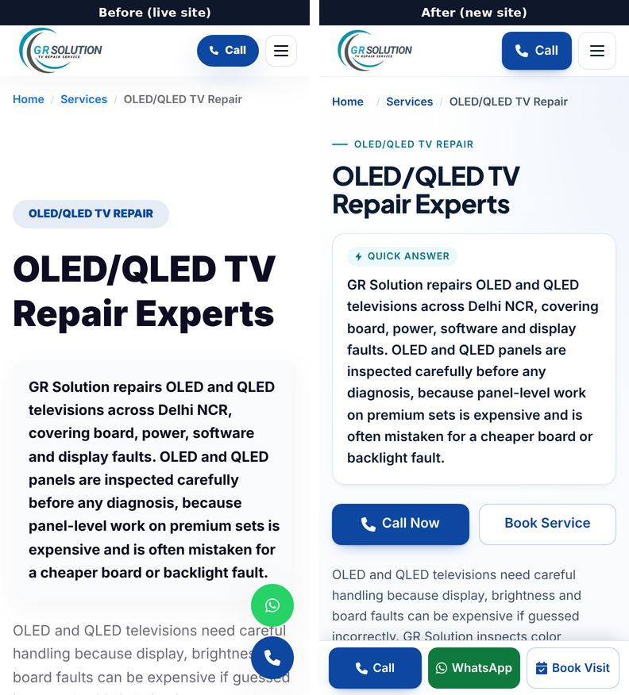
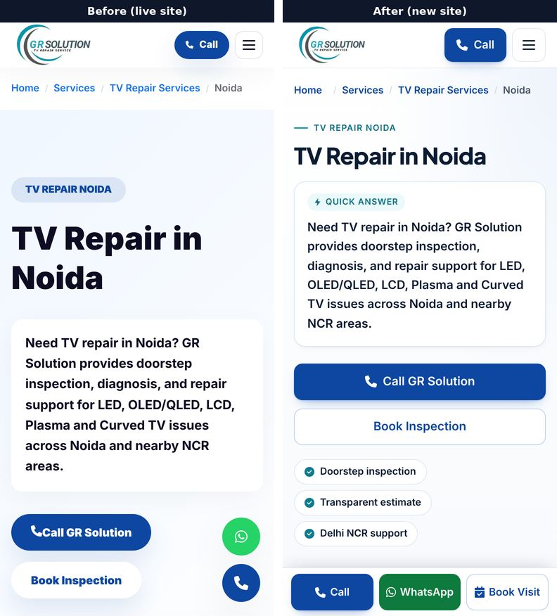
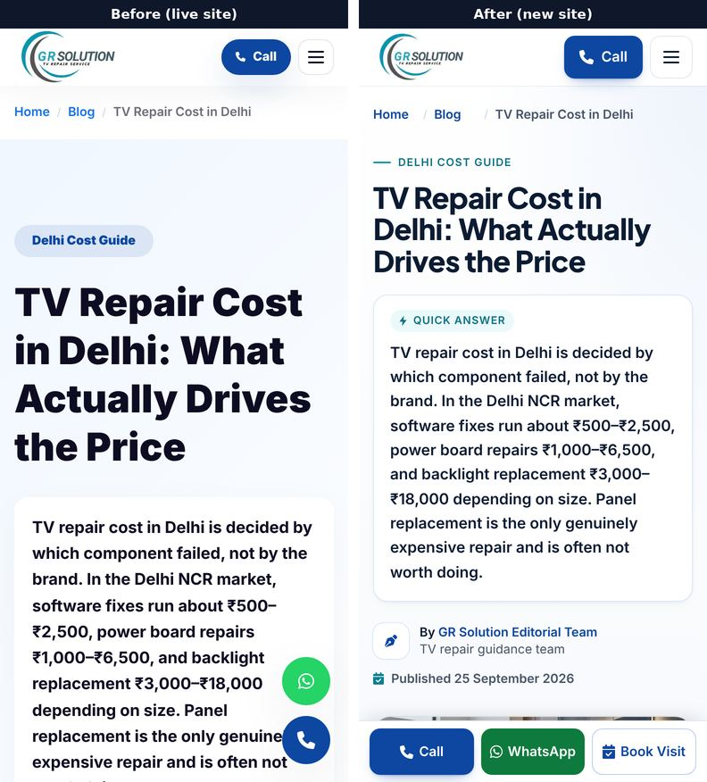

# GR Solution redesign: Phase 5 verification report

Status: **Phases 0–5 are complete on branch `claude/lucid-brown-1dbtvs`.**
Nothing is merged: merging into `main` deploys the site (GitHub Actions), so
that step is yours.

Everything below was measured on production builds (`next build` +
`next start`) and compared against the pre-redesign baseline from `main` at
`595b6c7` (see `docs/redesign/phase-0-audit.md`).

## At a glance

- **SEO / AIO / GEO: no unapproved change on any of the 108 crawled pages.**
  Titles, meta descriptions, canonicals, robots, Open Graph, JSON-LD,
  sitemap, robots.txt, redirects and llms.txt are identical. All 2,328 H1–H3
  headings keep their text and order, all 6,339 internal links keep their
  URL and anchor text, and 13,120 of the 13,142 body-text blocks are
  unchanged word for word. The other 22 are listed in
  [section 2.3](#23-signed-off-changes); they are form labels and one
  capitalisation fix.
- **Speed: same or faster than the live site.** Mobile Lighthouse, 7 runs per
  page alternating between the two builds: LCP median 2.59 → 2.37 s (home),
  2.53 → 2.52 s (service), 2.53 → 2.23 s (city), 2.63 → 2.36 s (blog index);
  the blog post is the same on average (2.44 → 2.46 s mean). Performance
  96–98, CLS 0, pages 5–33% lighter. An earlier version of this report said
  "at or better" from single batches; the rotation in
  [section 3](#3-speed) is the reliable measurement, and it also turned up a
  Next.js default that was costing 0.3–0.5 s (now switched off).
- **Accessibility: Lighthouse accessibility 90–95 → 98–99.** 16 of 16
  keyboard checks pass. The one remaining automated finding is heading order
  from the H4 headings you asked me not to change (decision D13).
- **Conversion:** sticky Call / WhatsApp / Book Visit bar on phones, calls
  to action in the first screen, a short callback form with inline
  validation, prefilled WhatsApp messages and GA4 events. The Book Visit
  button was tested end to end ([section 6](#6-forms-book-visit-and-tracking)).
- **Needs you:** see [section 7](#7-still-open-your-decisions).

## 1. What shipped

| Commit | What it does |
| --- | --- |
| `29f372a` | Next.js 16.2.9 → 16.4.0, React 19.2.7, exact pinned versions (D19). Zero content diff. |
| `a3f8d62` | Design system: colour tokens, type scale, spacing, component classes, self-hosted heading font. |
| `d02062e` | Shared components: native accordion FAQ, tables that stack into cards on phones, trust strip, Google rating, CTA blocks, service drawings. |
| `3c80545` | Mobile conversion: sticky action bar, accessible header and menu, one lead form for every capture point, Quick Enquiry dialog, GA4 events. |
| `4c58221` | Home page. |
| `82253b4` | Service, city, brand and locality templates (79 pages). |
| `3430477` | Blog index and blog posts. |
| `9f59ed0` | About, contact, pricing, reviews, services, brands, privacy, terms, 404, landing. |
| `0238bd9` | `docs/design-system.md`. |
| `de54228` | AVIF images with WebP fallback. |
| `4a04262` | Speed fixes: one 7 KB heading-font file, system font for body text, hero photo priorities, no logo preload. |
| `b2582f6` | Book Visit: visit requests are labelled and ask for the service area. |
| `79806fe` | SEO diff tool: signed-off changes reported separately. |
| `d32fab5` | Accessibility and tap-target fixes from this audit. |
| `486ce19` | Solid backgrounds instead of backdrop blur on phones (header, sticky bar, captions). |
| `6831637` | Blog index: text-first first screen on phones. |
| `0e26236` | Next.js setting `turbopackSharedRuntime: false` ([section 3.2](#32-a-framework-default-that-cost-lighthouse-03-05-s)). |

### Before and after

First screen on a phone (390 px wide), live site on the left:









Home page on a desktop (1440 px): [before](phase-5/home-desktop-before.jpg),
[after](phase-5/home-desktop-after.jpg).

## 2. SEO, AIO and GEO checks

### 2.1 Method

`tools/seo-audit/crawl.mjs` fetched every sitemap URL plus `/landing` and a
404 probe from a production build and recorded the head tags, every heading,
every link with its anchor text, every image with filename and alt text, all
JSON-LD, the visible text, NAP occurrences and invariant checks.
`diff.mjs` compared that with the baseline snapshot. A second, rendered crawl
(Chromium, after JavaScript) confirmed that nothing depends on JavaScript.

### 2.2 Results

| Check | Result |
| --- | --- |
| Pages crawled | 108 (106 from the sitemap, `/landing`, 404 probe) |
| Title, meta description, canonical, robots | identical on 108 / 108 |
| Open Graph / Twitter tags | identical on 108 / 108 |
| JSON-LD | identical on 108 / 108 |
| sitemap.xml, robots.txt, llms.txt, redirects | identical |
| H1–H3 headings | 2,328 / 2,328 same text, same order; exactly one H1 on every page |
| Internal links | 6,339 / 6,339 kept with the same anchor text |
| Body text | 13,120 / 13,142 blocks unchanged word for word (the 22 others are in 2.3) |
| FAQ text vs FAQPage schema | 0 mismatches (98 pages have FAQ schema) |
| Visible breadcrumb vs BreadcrumbList | same as before (73 pages match) |
| Answer-first summary as first block after the H1 | 64 pages unchanged; on the 44 brand pages it now comes first (D15) |
| NAP: phone links, visible numbers, schema telephone | unchanged on 108 / 108 |
| Server HTML vs rendered page | identical content; only Google Analytics' script appears after load, as before |
| Image filenames and alt text | unchanged, except the stock images in 2.3 |
| Main-content word count | 142,452 → 150,568 (+5.7%, additions only) |

Result of the diff with the signed-off rules applied: **0 violations**, 1,450
approved items, 52 items for review (2.4), 709 informational (for example
image loading attributes). Full report:
`tools/seo-audit/reports/current/seo-diff.md` after a fresh crawl (see 8).

### 2.3 Signed-off changes

These are the only removals or edits, each matched by a rule in
`tools/seo-audit/approved-changes.json`:

| Change | Where | Why |
| --- | --- | --- |
| Old form labels replaced: FULL NAME, PHONE NUMBER, SELECT BRAND, ISSUE SUMMARY, PROCEED TO BOOKING; Name, Phone, Service Required, Select service, Message, Send Enquiry | Quick Enquiry dialog (all pages), home and landing forms | Report §9 "Callback form", approved with "implement everything". |
| Stock photos replaced: the same technician photo on service cards → one drawing per TV type (alt text kept); team "lab" photos → real workshop photos; stock customer headshots removed | Home, landing, /services, service pages, /about, /reviews | Brief, Phase 3. |
| "oled/qled tv repair" → "OLED/QLED TV repair" (and LED, LCD, plasma, curved) in one sentence | 5 service pages | D18. Headings, FAQs and schema with the same lower-case text were left alone (see 7). |
| Summary box moved directly under the H1 | 44 brand pages | D15. Text unchanged. |

Site-wide additions with their own rules: sticky action bar, skip link,
footer map link and WhatsApp button, the new form fields, the trust strip and
Google rating, the call/WhatsApp blocks, and the blog "On this page" list.

### 2.4 Additions for review (52 items on 27 pages)

All additive; nothing was removed:

- **Related guides** under each blog post: links to three other guides with
  their existing titles and descriptions.
- **"On this page"** links on blog posts repeat the post's own H2 texts.
- **Blog index cards** show the date and reading time, or "Service guide"
  for the six cards that link to service pages (D16).
- **Home**: "How it works" steps, price teaser (the same ranges as
  /pricing), links to /pricing and /services/brands, Google review quotes.
- **Images added**: the per-type drawings and the About drawing, all with
  descriptive alt text; two real workshop photos on the home page.
- **Reviews**: initials avatars (AS, PV, RM) in place of stock photos.
- **Contact and pricing**: call / WhatsApp / "Book a visit" buttons in the
  hero.

### 2.5 New wording for your sign-off

New interface text (79 distinct strings). It restates promises the site
already made; no new claims. Strings shown on many pages:

| Pages | Text |
| --- | --- |
| all | Book Visit · Call · WhatsApp · Skip to content · Open in Google Maps |
| all (form) | Phone number · Your name (optional) · What's wrong? (optional) · Choose the closest match · No picture but sound works · TV won't turn on · Lines or spots on screen · Dim or flickering picture · No sound · Restarting or stuck on logo · Cracked or damaged screen · Smart TV, apps or Wi-Fi · Something else · Service area · Request a callback · We only use your number to call you back about your TV. |
| 87 | Not sure what's wrong with your TV? Talk to a technician. Diagnosis is free and you approve the price before any paid work. |
| 86 | Doorstep service — Delhi, Noida, Greater Noida & Ghaziabad · 90-day service warranty — Where applicable, explained before work · Genuine or compatible parts — Chosen with your approval · 4.9 on Google · 9 reviews |
| 12 | Want a firm figure for your TV? Book a doorstep diagnosis and approve the price before any paid work. |
| 15 | On this page · Related guides |
| dialog | Doorstep visit request (shown when Book Visit opened the form) |

Home only: "How it works"; "Call, WhatsApp or book online / Tell us the TV
brand, screen size and what is going wrong."; "Free doorstep diagnosis / The
technician finds the part that failed and gives you a firm estimate.";
"Approve, then we repair / No paid work starts until you approve it.
Warranty terms are explained first."; "Typical repair costs in Delhi NCR /
Know the likely price before the technician arrives. / Market ranges
including part and labour, from the smallest to the largest screens.
Diagnosis is free and you get a firm figure before any paid work."; "See the
full price guide"; "Find your brand"; "From our Google reviews"; "Read all
reviews on Google". Landing only: "Firm estimate before any paid work",
"90-day service warranty where applicable".

The diagnosis, warranty and parts lines depend on the facts still open in
D2, D7 and D8 (section 7); they repeat what the site already says.

## 3. Speed

### 3.1 Mobile Lighthouse

Lighthouse 13.5 with its default mobile settings (Moto G Power, simulated
slow 4G, 4× CPU slowdown), Google Analytics blocked so runs are comparable.
The live site (`main`, Next.js 16.2.9) and the new site were built for
production, served side by side and measured in rotation, one run at a
time, 7 runs per page and build:

| Page | LCP median, live → new | LCP mean | Performance | TBT | CLS | Page weight |
| --- | --- | --- | --- | --- | --- | --- |
| Home | 2.59 → 2.37 s | 2.58 → 2.47 s | 97 → 98 | 43 → 48 ms | 0 → 0 | 443 → 299 KB |
| Service (OLED/QLED) | 2.53 → 2.52 s | 2.44 → 2.41 s | 96 → 97 | 38 → 37 ms | 0 → 0 | 317 → 288 KB |
| City (Noida) | 2.53 → 2.23 s | 2.46 → 2.36 s | 96 → 98 | 40 → 51 ms | 0 → 0 | 327 → 298 KB |
| Blog index | 2.63 → 2.36 s | 2.56 → 2.41 s | 96 → 98 | 33 → 40 ms | 0 → 0 | 329 → 312 KB |
| Blog post | 2.48 → 2.63 s | 2.44 → 2.46 s | 97 → 96 | 41 → 41 ms | 0 → 0 | 363 → 297 KB |

First contentful paint is 1.5 s on every page in both builds.

- **Four pages are the same or faster; the blog post is the same on
  average.** Its median is higher only because both builds land on one of
  two levels (see 3.3): each had 3 fast runs (2.0–2.25 s) and 4 slow ones
  (live 2.48–2.79 s, new 2.63–2.68 s), and the median falls on a slow one.
- **Lighter on every page**: images 24–47 KB instead of 63–185 KB (AVIF and
  right-sized files). The new design adds 7 KB of CSS, the 7 KB heading font
  and 3–6 KB of HTML; JavaScript is 158 KB against 167 KB live.
- **Like for like**, against the old design rebuilt on Next.js 16.4 (commit
  `29f372a`, same setting as in 3.2) the redesign is 0.3 s faster on home,
  level on service, city and blog post (within 0.05 s on average) and about
  0.13 s slower on the blog index (2.41 s against 2.28 s mean), which is
  still faster than the live site's 2.56 s.
- The 2.5 s LCP target: the new site's medians are under it on home, city
  and blog index; service (2.52 s) and the blog post (2.63 s median, 2.46 s
  mean) sit on the line, as the live site's do (2.53 s and 2.48 s). On this
  machine Lighthouse puts both builds of every page around 2.5 s, so the
  working target is "no worse than live", which holds.

Every run, plus the old-design-on-16.4 build:
`tools/seo-audit/reports/phase-5/lighthouse-ab/`. How to repeat the
comparison: `tools/seo-audit/README.md`, "Comparing two builds".

### 3.2 A framework default that cost Lighthouse 0.3–0.5 s

Next.js 16.4 (the security upgrade, D19) switched on a shared browser
runtime that inlines a small bootstrap script into every page, just before
the page's entry script. An inline script has to wait for the stylesheet,
so the 3 KB entry script ended up running after the large framework scripts,
and React's start-up work happened in its task.

That matters to Lighthouse's simulation: it counts every script that had
finished downloading by the first paint as blocking the LCP, unless that
script's own long task started after the paint. With the entry script
running last, the 72 KB React script stayed in the estimate: in 21 of 25
spot-check runs on 16.4's default (old and new design alike) against 1 of 8
on the live site, and those runs came out 0.3–0.5 s slower.

`next.config.js` now sets `experimental.turbopackSharedRuntime: false`. It
keeps the per-page runtime that 16.2.9 used, so the HTML loads its scripts
exactly as the live site does, with all of 16.4's security fixes. Visitors'
first paint never depended on this (every script is `async`); it is the lab
figure in PageSpeed Insights that changes. The option is marked
experimental, so re-check it on the next Next.js upgrade.

### 3.3 Reading PageSpeed Insights after the merge

On this site Lighthouse's mobile LCP tends to land on one of two levels for
the same build, roughly 2.0–2.3 s or 2.5–2.8 s. Which one depends on
whether React happens to start running a few milliseconds before or after
the first frame is shown. The live site does the same (its blog post ranged 2.02–2.79 s).

- Run PageSpeed Insights 3–5 times per page and compare the median with the
  live site's median, not one run with another.
- The numbers Google uses for ranking are the field data (Chrome UX Report)
  at the top of the PageSpeed Insights page; they take about 28 days to
  reflect the new design.

### 3.4 What made it fast

- **One heading font file of 6.8 KB** (Plus Jakarta Sans 800, trimmed to the
  characters the site uses), preloaded. Body text uses the device's own font
  (Roboto on Android, San Francisco on iPhone), exactly as the old site did.
- **D20 changed after measuring.** Inter for body text (the approved D20
  option) added four font files that load before the largest text paints
  and pushed mobile LCP 0.3–0.6 s past the old site. The report's D20 entry
  promised to keep the variant that does not regress, so body text stayed
  on the system font (the D20 alternative). Say the word if you prefer Inter
  anyway; it is a one-file change.
- **AVIF images** with WebP fallback (the hero is 43% smaller).
- **Right-sized images**: every image has `sizes`, so phones download a
  640–750 px file instead of 1,920 px.
- **Text first on phones.** On service, city, brand, locality and blog pages
  the largest element on a phone's first screen is text (the H1, the
  answer-first summary or, on the blog index, the featured article's
  summary), as on the live site. On the home page it is the hero photo,
  which is preloaded at high priority for that reason. Hero photos on
  service, city, brand and blog pages are preloaded at high priority on
  desktop only, where they are the largest element; on phones they sit
  below the summary and load at low priority. On the blog index, phones
  skip the hero photo (the featured card just below shows the same photo)
  and the featured card puts its photo after its text.
- **No blur effects on phones.** The sticky header and action bar use solid
  white: `backdrop-filter` blur slows the first frame in the software-rendered
  Chrome that Lighthouse uses.
- **The Next.js runtime setting** in 3.2.
- No new JavaScript libraries.

## 4. Responsive check

`tools/seo-audit/screenshots.mjs` at 360, 390, 414, 768, 1280 and 1440 px on
the five reference pages and /contact (36 measurements,
`reports/phase-5/responsive/responsive.md`):

- No horizontal scrolling at any width.
- CLS 0 everywhere.
- H1 is 32 px on phones (1–4 lines depending on the title), 50–52 px on
  desktop; no H1 takes more than 18% of a phone screen.
- A call button is inside the first screen on home, service, city and
  contact pages at every width. Blog pages rely on the sticky bar on phones
  and the header on desktop.
- The sticky bar hides while a form or the footer is on screen and while
  the keyboard is open, so it never covers a submit button or the NAP
  (tested on /contact).
- Tap targets: every button and link list is at least 48 × 48 px on phones
  and tablets. The exceptions are the skip link (invisible until focused)
  and two links inside sentences (blog byline, "See sources and method"),
  which WCAG exempts.

## 5. Accessibility

axe-core (WCAG 2.2 AA plus best practices) on 14 templates at 390, 1024,
1280 and 1440 px: the only finding is **heading-order**, caused by the H4
footer column titles and home feature titles sitting under H2s. Changing
them changes heading tags, which the guardrails freeze (D13, open).

Keyboard checks (scripted, all pass):

1. Skip link is the first Tab stop, visible, and moves focus to the content.
2. Mobile menu opens from the keyboard, keeps focus inside, Esc closes it
   and returns focus to the toggle.
3. Services dropdown opens from its button; Esc closes it and keeps focus.
4. FAQ items open and close with Enter and Space.
5. Book Visit and Quick Enquiry open the dialog with focus in the phone
   field; focus never reaches the page behind it; Esc closes it and returns
   focus to the button that opened it.
6. Submitting an empty form shows the error next to the phone field and
   moves focus there.
7. The sticky bar never covers the contact form's submit button or the
   footer.

## 6. Forms, Book Visit and tracking

Every form (Quick Enquiry dialog, Book Visit, contact page, home and landing)
posts to the existing FormSubmit inbox `kamleshg9569@gmail.com` with a copy
to `deepeshpatelinfinix@gmail.com` (`data/siteConfig.js`). The emails include
the page and whether the visitor came from an ad or search.

Book Visit was tested end to end in a browser with the FormSubmit request
intercepted (no real email sent): the dialog opens with a "Doorstep visit
request" badge, the request goes to the address above with `_cc`, subject
"New doorstep visit request (Book Visit)", `source: Book Visit button`, the
phone number normalised to 10 digits, the area, page and channel, and the
thank-you message appears. Note that `info@grsolution.co.in` does not
receive form emails; say if it should.

GA4 / GTM events (see `docs/design-system.md`): `click_call`,
`click_whatsapp`, `cta_click`, `form_start`, `form_submit`, each with the
page path and section. The existing `generate_lead` and `phone_call_click`
events are unchanged.

## 7. Still open: your decisions

| # | Decision | Status |
| --- | --- | --- |
| D1 | Which phone number is the NAP. Pages still show +91 93155 15700 (search) and +91 99902 83890 (ads, home, landing, schema) as before. | Unchanged; needs your call. |
| D2, D4, D7, D8 | Exact wording of "free diagnosis", visit/callback times, warranty terms, parts. | Copy unchanged; the trust strip repeats today's wording. |
| D3, D5, D6, D9 | "24/7", "#1", "15+ years / 15,000+ customers", "laboratory" claims. | Copy unchanged. |
| D10 | Are Amit Sharma, Priya Verma and Rahul Mehta real customers? | Their stock photos are removed; names and quotes kept until you confirm. |
| D11 | Real photos (shot list in `docs/design-system.md`). | Drawings stand in on the About hero and service cards. |
| D13 | H4 footer/feature titles (axe heading-order). | Unchanged; needs approval to change heading tags. |
| D16a | Blog "Featured" card links to a service page, not a post. | Kept. |
| D18 (rest) | Lower-case service names inside some H3s, FAQs and city summaries ("Safe handling for led tv repair"). | Not changed: they are frozen headings, FAQ schema and summaries. Approve and I will fix them with the schema. |
| D20 | Inter for body text cost 0.3–0.6 s of mobile LCP. | System font used instead; confirm. |
| Copy | New wording in 2.5. | Please confirm or edit. |

## 8. Re-running the checks

```bash
NEXT_PUBLIC_GA_MEASUREMENT_ID=G-0RQ8C75FPT npm run build && npx next start -p 3100 &
cd tools/seo-audit && npm ci
node crawl.mjs --base http://127.0.0.1:3100 --out snapshots/current --rendered
node diff.mjs --base snapshots/baseline --head snapshots/current --out reports/current/seo-diff.md
node lighthouse.mjs --base http://localhost:3100 --out reports/current/lighthouse --runs 5
node screenshots.mjs --base http://localhost:3100 --out reports/current/responsive
```

To compare two builds for speed, alternate them run by run (loop in
`tools/seo-audit/README.md`, "Comparing two builds") and summarise with
`ab-summary.mjs`.

`diff.mjs` exits with an error if anything frozen changes that is not in
`approved-changes.json`.
